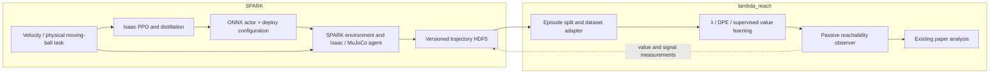

# SPARK integration

The new 29-DoF path requires `spark_dev` and this repository. SPARK owns policy
training, the robot, physical ball task, MuJoCo/Isaac agents, policy inference, and
HDF5 collection. This repository owns the λ/DPE/supervised algorithms, episode
adapters, value checkpoints, safety signals, and evaluation. Neither
`unitree_rl_lab-lambda` nor `unitree_mujoco-lambda` is imported by this path.

The maintained target is the user-selected built-in 29-DoF G1. The
37-action flat/rough/collision extension
and original deployment scripts are retained as reproduction references. The
new PPO task includes SPARK-owned randomization and curriculum. SPARK-trained
nominal and avoidance actors have passed their policy gates in both simulators.
Exact original-plant learning parity, hardware and full paper reproduction
remain outside this replacement's validated scope.

The [controlled replacement verification](SPARK_REPLACEMENT_VALIDATION.md)
found agreement in model inference and tested fall outcomes, but differences
in avoidance observations, control timing, trajectories and value predictions.
SPARK provides the sim-to-sim deployment path for the built-in 29-DoF model;
trajectory differences from the original deployment are accepted. The
[held-out value evaluation](SPARK_VALUE_ACCURACY.md) documents monitor performance;
exact agreement with the paper is not a requirement for the current viewer verification.

Locomotion training now has a SPARK-owned recipe, randomization/curriculum,
checked PPO resume, ONNX export and rollout evaluation workflow. See the
[SPARK training guide](https://github.com/YIFANSUN98/spark_dev/blob/master/example/unitree_g1/locomotion/TRAINING.md).
It uses SPARK's Isaac tensor backend and built-in 29-DoF G1; the auxiliary
Unitree RL repository is not imported. The host now has matching NVIDIA
580.178.04 kernel/userspace libraries; the old driver workaround is unnecessary. Fresh
from-scratch training and policy-specific rollout/value evaluation use the
[retraining workflow](SPARK_RETRAINING.md). A fresh actor and its own monitor
completed rollout/value evaluation in September but failed walking qualification;
that historical [execution report](SPARK_RETRAINING_RESULTS.md) remains available.
The [October training audit](SPARK_TRAINING_PARITY.md) records the newly qualified
nominal and avoidance actors and the matching monitor. All policy, held-out
monitor-accuracy and online-execution gates passed. The default viewer now
uses that qualified SPARK-trained pair.
For a newly trained policy, generate new labelled rollouts and retrain/evaluate
the reachability value; the current value's policy-hash guard remains enabled.

## Models used by the viewer

The default avoidance controller was trained in SPARK and has SHA-256
`90735dd9f346ab99365ffbaf047bde219ad99df8129b2e3e976dbc21408eca54`.
Its lineage starts with fresh SPARK Isaac teachers; released actors were used
only as diagnostic references. The new λ monitor was trained from scratch on
rollouts from these exact policy bytes. Seed 2 was selected using validation
data before the 512-episode test: temporal recall 97.76%, false-safe rate 3.69%,
false-alarm rate 11.00%, and sample-value error .1347. See the October report
for confidence intervals, baselines and limits.

The hash-checked pair is
`logs/safety_analysis/spark_29dof/spark_replacement_20261005_v2/monitor/bundle.json`.
`SPARK_MONITOR_BUNDLE` or explicit `--bundle` selects another saved pair.
This is a local run artifact, not a checkpoint included in Git. A fresh checkout
can use SPARK's bundled avoidance actor and the
[monitor training workflow](SPARK_RETRAINING.md#train-a-monitor-from-that-exact-policy)
to create its own bundle.
The earlier released-policy monitor remains a historical experiment in the
[September value accuracy report](SPARK_VALUE_ACCURACY.md).

## Open the monitored MuJoCo viewer

From this repository root:

```bash
bash deploy/avoid/run_spark_monitor.sh
```

The launcher uses `.venv/bin/python` and the qualified bundle above, supplying
its actor, configuration and value together without downloading a released actor.
MuJoCo now uses SPARK's built-in `UnitreeG1WholeBodyDynamic1Config` and its
`unitree_g1/mjcf/g1_29dof_whole_body.xml`, including the white background and
grid floor from the standard G1 examples. The locomotion adapter adds the
physical ball and supplies the checkpoint's observation and PD control contract.
Both controller and value were trained through the SPARK workflow.
It opens the MuJoCo viewer, targets real-time speed, and shows the measured
`Safety signal l(x)`, learned `Reachability V(x)`, and predicted safe/unsafe state.
The monitor observes the controller; it does not alter its actions.
Closing the window stops collection and saves the current episode as truncated.
The default is four 20-second episodes; for a longer single episode:

```bash
bash deploy/avoid/run_spark_monitor.sh --episodes 1 --steps 15000
```

For forward walking at 0.3 m/s during the ball-avoidance verification:

```bash
bash deploy/avoid/run_spark_monitor.sh --velocity-command 0.3 0 0
```

If the local graphics driver cannot create a GLX context, use software OpenGL:

```bash
bash deploy/avoid/run_spark_monitor.sh --software-rendering --velocity-command 0.3 0 0
```

This option selects Mesa only for this process, disables viewer shadows and
reflections, and limits display updates to 20 FPS. Policy inference, monitoring,
physics and trajectory recording still run every control step. Use
`--viewer-fps N` to override the display rate; higher rates can slow software
rendering. Each run saves its checkpoint hash alongside the trajectory and
reports measured `actual_control_hz` and `real_time_factor` in its summary JSON.
See the [latency measurements](SPARK_MONITOR_PERFORMANCE.md) for the viewer
bottleneck and the verified real-time configuration.

The policy and value run once per 20 ms simulation control step (50 Hz). Ball launches
occur automatically every 3–5 seconds. `V(x) > 0` displays `UNSAFE`; the signal
`l(x)` is measured from the simulation, while `V(x)` predicts future violations.
CPU inference defaults to one thread to keep small online batches responsive.

Earlier migration runs overrode the robot configuration's scene with the
original Unitree XML, which has a blue background and different robot dynamics.
The lower-level monitor CLI and SPARK benchmark retain `--mujoco-scene released`
for explicit historical actor/value pairs. The new qualified bundle requires
`--mujoco-scene spark`. Runs print the loaded XML and record the scene profile, robot config,
XML path and XML SHA256 in HDF5 metadata. The XML hash covers that file, not its
referenced meshes or included files; the released assets have a separate manifest.

The historical 200-update monitor was trained on released-scene rollouts;
its integration measurements below apply to that earlier checkpoint. The
current default uses the October SPARK-trained actor and its seed-2 value model.

Every invocation saves a new run under
`logs/safety_analysis/spark_29dof/viewer/run_*/trajectory.hdf5`.
The learned checkpoint and accepted rollout datasets were copied into this
repository's ignored `logs/` directory and verified by hash. They are local
experiment outputs, not source files committed to Git. Their original training
metadata remains intact; `artifact_locations.json` records the historical
copied artifacts, while the new bundle records its own current paths and hashes.

All maintained monitor/setup/launcher code lives in this repository; reusable
simulation code lives in SPARK. The sibling `migration_artifacts` and
`investigation_2026-09-22` directories were removed at the user's request after
verifying that the active environment, datasets and checkpoint do not depend
on them. Small historical migration records are retained under
`logs/safety_analysis/spark_29dof/provenance/`. Original source paths in training
metadata are historical provenance and no longer exist.



## Environment and commands

Install SPARK as documented in its root README and
`example/unitree_g1/locomotion/README.md`. Install this package with
`python -m pip install -e safety_value`. Algorithm-only training does not require
IsaacLab or `hj_humanoid`; the SPARK monitor additionally needs SPARK and its
chosen simulator. Keep the old IsaacLab 2.3 environment separate from SPARK's
Isaac Sim 6 environment.

The locally tested environment is `.venv/bin/python` inside this repository,
an isolated overlay on the existing SPARK environment. To recreate it here:

```bash
bash scripts/setup_spark_env.sh /path/to/installed/spark/python
```

Pass the Python executable from an installed SPARK environment on another
machine. The script uses `uv`, preserves the base environment, and installs the
pinned additions in `requirements/spark-overlay.txt` plus this package.
It uses Python 3.12.13, NumPy 2.3.1,
Torch 2.11.0+cu128, MuJoCo 3.8.0, ONNX Runtime 1.29.0, and h5py 3.16.0.
Isaac runs use Sim 6.0.0.1 and the local IsaacLab development checkout reporting
13.0.0. Active model/data/viewer outputs live in `logs/safety_analysis/spark_29dof/`.
Historical migration commands, environment inventories and acceptance summaries
remain in that directory's ignored `provenance/` subdirectory. Temporary
investigation environments and intermediate migration outputs were deleted.

Run these commands from this repository root after `source .venv/bin/activate`.
Use a new output directory when repeating the example.

```bash
# Collect policy inputs, simulator state, and research-specific labels.
POLICY_RUN=/path/to/spark_dev/example/unitree_g1/locomotion/pretrained/avoidance
python safety_value/scripts/2_safety_analysis/run_monitor.py \
  --family avoid --backend mujoco --episodes 4 --steps 1000 --seed 52 \
  --policy "$POLICY_RUN/policy.onnx" --config "$POLICY_RUN/deploy.yaml" \
  --output outputs/spark_reachability/labelled.hdf5

# Fit a reduced λ model directly from SPARK episodes; no pickle preprocessing.
python safety_value/scripts/2_safety_analysis/train.py \
  --spark_data outputs/spark_reachability/labelled.hdf5 \
  --safety_analysis_root "$PWD/outputs/spark_reachability" \
  --algo lambda_reachability --model_tag lambda_reachability --run_name smoke \
  --lambda_param .99 --max_horizon 100 --total_steps 200 --eval_steps 50 \
  --batch 32 --hidden_dims 32 32 --seed 0 --device cpu \
  --weight_hinge_lb 0 --weight_hinge_mono 0 --weight_bce 0

# Execute the same actor with the learned value; emit a legacy analysis adapter.
python safety_value/scripts/2_safety_analysis/run_monitor.py \
  --family avoid --backend mujoco --episodes 4 --steps 1000 --seed 62 \
  --policy "$POLICY_RUN/policy.onnx" --config "$POLICY_RUN/deploy.yaml" \
  --value outputs/spark_reachability/results/lambda_reachability_smoke \
  --output outputs/spark_reachability/monitored.hdf5 \
  --legacy-output outputs/spark_reachability/results/lambda_reachability_smoke/inference/seed_62/dataset.hdf5

python safety_value/scripts/3_result_analysis/evaluate_inference.py \
  --base_dir outputs --sa_roots spark_reachability \
  --methods lambda_reachability_smoke --seed 62 --plot_worst 0 --plot_best 0
```

Add `--viewer` to the monitor CLI to enable rendering, live value readouts and
real-time pacing; without it the run is headless and unpaced.
`--backend isaac` runs the same monitor through SPARK's Isaac adapter.
`--family push` selects the 480-input actor and push signal profile.
`--policy` and `--config` accept a SPARK-trained actor and its deploy metadata.
Value models with policy lineage are rejected if the actor hash differs from
their training data. External released ONNX values without lineage cannot
provide that check.

For the other reduced training paths, replace `--algo` and `--model_tag` with
`dpe` or `supervised`; omit λ-specific options. Both were executed on SPARK data.
To export a value for ONNX execution:

```bash
python deploy/tools/export_onnx.py \
  --safety_value_dir outputs/spark_reachability/results/lambda_reachability_smoke \
  --output outputs/spark_reachability/value.onnx
```

The exporter and monitor use the same checkpoint loader. Twin λ critics export
their mean; the training bootstrap still uses the target critics' minimum.
The ONNX file embeds training metadata, including available policy lineage.

## Data and endpoint semantics

`safety_analysis_algos/spark_dataset.py` consumes `spark.trajectory.v1`.
SPARK stores T policy inputs/actions, T+1 states, and T post-action labels.
The adapter explicitly preserves the paper recorder's pairing of `obs[t]` with
the post-action signal; SPARK itself does not assign this research interpretation.
Events cut segments before the event-marked sample, matching existing processing.

Training creates or reuses a content-hashed episode split JSON. Whole episodes
are held out; train/test cannot overlap. Future suffixes are views over shared
segment arrays, avoiding the old quadratic on-disk pickle expansion. The dataset
returns the existing seven training fields plus endpoint metadata understood by
the λ trainer.

`--spark_endpoints bootstrap` is the new λ default: time limits and event cuts
bootstrap the model, while actual terminal endpoints use the observed signal.
`--spark_endpoints legacy` restores the original last-available-sample rule.
Existing pickle callers preserve their original behavior. DPE and supervised
learning retain their own existing target definitions. The new episode split
and unbalanced sample distribution differ from the old balanced pointwise split;
their accuracy numbers must not be presented as a controlled algorithm comparison.
Training metadata now records δ, absorbing baseline, dataset/split hashes,
endpoint mode, source metadata and actor hash.

`monitoring/spark_monitor.py` owns the named simulation avoidance/push and
hardware-push signal conventions. It uses tilt, torso contact, flat-ground
clearance, and a ground-filtered ball contact latch. Simulation and hardware
proxies remain distinct. The callback records values and signals and does not
change the policy command. A hardware signal profile is not a hardware driver.

## Historical integration checks and paper-reproduction scope

The local migration executed released-policy MuJoCo collection, labelled data,
λ/DPE/supervised reduced training, checkpoint reload, monitored MuJoCo and Isaac
runs, existing inference evaluation, and value ONNX round trips. SPARK's native
PPO port executed both 480-input push and 510-input avoidance updates and ONNX
round trips. The newly initialized, briefly trained actor falls in MuJoCo; it is
only a training-to-deployment code-path test.

The initial 200-update λ evaluation contained 4,000 samples and 23 event segments,
including 3 unsafe segments: temporal recall 0.2334, detection rate 2/3,
sample-value MSE 0.1843, invariant accuracy 0.9030, invariant false-positive rate
0.8957. These are smoke-test measurements, not paper reproduction or evidence
of a useful safety monitor.
The held-out training episode was entirely safe, which limits sign-accuracy
interpretation further.

The data review found and fixed a stale-contact artifact: after teleporting a
grounded ball, its previous ground impulse could be interpreted at the new launch
height. Both SPARK simulators now clear ball contact history when starting a new
flight. This is an explicit behavior correction; diagnostic runs before the fix
are retained separately from the `accepted_*` validation artifacts.

The current 29-DoF acceptance gates and results are in the October training
audit and retraining guide. Exact historical paper/hardware reproduction would
additionally require the following work; it is not required to retire the two
auxiliary repositories from the maintained 29-DoF workflow:

1. Match observation/reward/termination behavior against the archived task;
   validate the new SPARK randomization/curriculum in Isaac, then compare
   multi-seed learning with the original robot plant if exact reproduction is required.
2. Restore SPARK profiles for the 37-action flat, rough and collision suite.
   Obtain the actual pretrained checkpoints and resolved historical experiment
   configurations; a 29-DoF checkpoint cannot substitute for these.
3. Run full value/algorithm sweeps on the original datasets and fixed split IDs,
   reproduce paper tables with uncertainty estimates, and validate hardware
   feedback timing, MoCap freshness, mode transitions and shadow monitoring.
4. Recreate and archive the original environment before claiming full
   reproduction; the temporary investigation environment was removed during
   workspace cleanup. Original source commits remain in the archived checkouts.

The original checkpoints, datasets, hardware annotations and exact historical
environment required for the full paper gates were not present in the supplied
repositories. The temporary investigation/migration directories were removed
at user request. The two legacy checkouts were later moved intact to
`/home/yifan/Research/Lambda_legacy_archive_20261005/` after the replacement
passed qualification. Only `lambda_reach` remains in the active Lambda project
folder, alongside its external SPARK dependency. The SPARK integration and
pretrained actors are on SPARK `master` at `fd8e4df`; this repository's integration
is maintained on the separate `spark` branch. Historical reports below this
workflow describe the staging and validation status at their execution dates.
